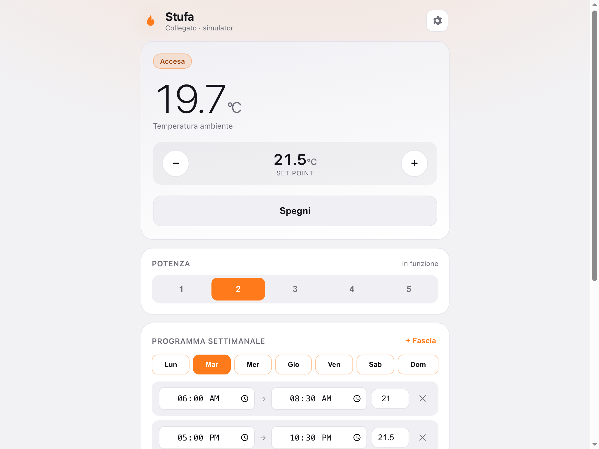

# Stufa

Sostituto completo dell'app del produttore per una stufa a pellet: una **PWA** installabile su
iPhone più un **bridge** locale che parla con la stufa, esegue il programma 24/7 e registra
eventi e allarmi. Niente cloud di terzi, niente account, nessuna dipendenza da installare:
solo Node.js 18+.



```
iPhone (PWA installata)  ──HTTPS──▶  bridge (Raspberry Pi / NAS / PC)  ──▶  stufa
```

Perché serve il bridge: una PWA da sola non può comandare una scheda elettronica — iOS sospende
le app in background e il browser non parla con l'hardware. Il bridge è la parte sempre accesa,
sostituisce il cloud del produttore; il telefono è solo l'interfaccia.

## Stato del progetto

Funzionante e verificato **con il simulatore e con un dispositivo HTTP finto**. Mai provato su
una stufa reale.

| Pezzo | Stato |
| --- | --- |
| PWA: accensione, set point, potenza, programma, eventi, grafico | fatto e verificato nel browser |
| Bridge: API REST, SSE, scheduler 24/7, persistenza, token | fatto e verificato (`curl`) |
| Adattatore `simulator` | fatto |
| Adattatore `http` (qualsiasi dispositivo con API HTTP) | fatto, verificato contro un device finto |
| Adattatore per schede Brahma (app Magic Stove) | **manca**: protocollo non pubblico |
| Prova su stufa vera | **manca** |

## Avvio rapido

```bash
cd stufa
PORT=8787 ADAPTER=simulator node server/server.js
```

Il bridge stampa gli indirizzi su cui è raggiungibile e dove ha salvato il token
(`stufa/server/data/token.txt`). Apri l'app all'indirizzo del bridge, ingranaggio → incolla
indirizzo e token → **Collega**.

Con `ADAPTER=simulator` (default) non serve nessuna stufa: l'interfaccia è completa e usabile.

Documentazione completa dell'app, dell'API, degli adattatori, di HTTPS e dell'avvio automatico
con systemd: [`stufa/README.md`](stufa/README.md).

## Struttura

| Percorso | Contenuto |
| --- | --- |
| `stufa/index.html`, `style.css`, `app.js` | PWA: dashboard, programma, eventi, grafico |
| `stufa/sw.js`, `manifest.webmanifest`, `icons/` | installazione e cache offline |
| `stufa/server/server.js` | bridge: API, scheduler, store su file, adattatori |
| `stufa/server/adapter.example.json` | mappatura HTTP d'esempio |
| `stufa/server/data/` | dati runtime (**non versionati**): token, stato, programma, eventi, storico |
| `stufa/docs/` | screenshot |

## Come riprendere il lavoro

### Cosa persiste e cosa no

- **Persiste**: tutto il codice e la documentazione in git (dopo il push su `main`). I file del
  workspace sono inoltre sottoposti a checkpoint.
- **Non persiste**: i processi in esecuzione. Al rientro il bridge è spento e va riavviato.
- **Non persiste**: `stufa/server/data/`. Viene ricreato al primo avvio con un **token nuovo**,
  quindi va reincollato nell'app. Il programma settimanale e lo storico ripartono vuoti.
- L'hostname di anteprima del workspace cloud può cambiare: va riagganciato.

### 1. Portare il codice sul portatile

```bash
git clone https://github.com/jjLandrew/to-do-list.git
cd to-do-list
git log --oneline -3          # deve esserci il commit dell'app Stufa
```

Se il repository è già clonato, basta aggiornarlo:

```bash
git pull
```

Il branch di lavoro usato in chat è `freebuff/7cc0b9326022e993c08f7b03`; il lavoro è stato
pushato su `main`, quindi un clone normale è sufficiente.

### 2. Avviare il bridge

```bash
cd stufa
PORT=8787 ADAPTER=simulator node server/server.js
```

Output atteso: gli indirizzi disponibili (con l'indicazione di quale usare dal telefono) e il
percorso del token.

### 3. Ricavare il token e collegare l'app

```bash
cat stufa/server/data/token.txt
```

Poi nell'app: ingranaggio → indirizzo del bridge → token → **Collega**. Se l'app è aperta
dall'indirizzo del bridge, il campo indirizzo può restare vuoto ("stesso indirizzo").

### 4. Riaprire l'anteprima in chat

Chiedi di riavviare anteprima e bridge. Lato agente: il bridge va avviato sulla porta riservata
del workspace (`PORT=3000 HOST='::' ADAPTER=simulator DEV_NO_AUTH=1 node server/server.js`),
poi si richiama `cloud_show_dev_server` con la porta 3000. `DEV_NO_AUTH=1` è accettato **solo**
con il simulatore: serve a usare l'app senza token durante l'anteprima.

### 5. Checklist di ripresa (30 secondi)

```bash
curl -s http://127.0.0.1:8787/api/health                 # {"ok":true,"adapter":"simulator"}
curl -s -H "Authorization: Bearer $(cat stufa/server/data/token.txt)" \
     http://127.0.0.1:8787/api/state | head -c 300        # stato + programma + eventi
curl -s -H "Authorization: Bearer $(cat stufa/server/data/token.txt)" \
     http://127.0.0.1:8787/api/network                    # indirizzi + raggiungibilità stufa
```

Poi nell'app: "Accendi" deve cambiare lo stato, e la card **Eventi** deve mostrare
`Accensione (app)`.

### 6. Cosa era in sospeso

1. **Adattatore per la stufa vera.** Serve l'ID della stufa, che l'app del produttore mostra al
   login (12 caratteri esadecimali). È un identificativo del dispositivo: va tenuto fuori dal
   codice e dai file versionati, passandolo solo come variabile d'ambiente o campo in
   `stufa/server/data/adapter.json` (ignorato da git). Il formato corrisponde a un MAC senza
   separatori e il prefisso indica un modulo Espressif (ESP8266/ESP32): da verificare se espone
   qualcosa in locale (porte HTTP, TCP, UDP) o se parla solo con il cloud del produttore. Se
   parla solo col cloud, la strada è intercettare il traffico del modulo (app del produttore +
   proxy tipo mitmproxy sulla rete di casa) e mappare gli endpoint nell'adattatore.
2. **Prova su hardware reale**: nessun test è stato fatto su una stufa; l'adattatore HTTP è stato
   validato solo contro un dispositivo finto.
3. **Verifica sul campo della rete mista 2,4/5 GHz**: la logica è pronta (dual-stack, elenco
   indirizzi, filtro link-local), manca la prova su un router mesh reale.

## Rete: 2,4 GHz e 5 GHz

App e bridge sono **band-agnostici**: il telefono può stare su 5 GHz. Il limite 2,4 GHz è nel
modulo Wi-Fi **dentro la stufa**, ed è hardware. Serve solo che telefono e bridge siano nella
stessa rete IP. Il bridge ascolta in dual-stack IPv4 + IPv6, stampa i suoi indirizzi all'avvio e
li mostra nelle impostazioni dell'app, escludendo loopback e link-local.

Dettagli e casi problematici (sottoreti separate, AP isolation, reti IPv6): sezione
"Reti 2,4 GHz e 5 GHz" in [`stufa/README.md`](stufa/README.md).

## Sicurezza

- Il token del bridge è generato al primo avvio in `stufa/server/data/token.txt` (permessi 600) e
  non è versionato. Per ruotarlo: cancella il file e riavvia.
- Non esporre il bridge su internet senza HTTPS: meglio VPN (Tailscale/WireGuard) o rete locale.
- `DEV_NO_AUTH=1` disattiva l'autenticazione ed è rifiutato se l'adattatore non è il simulatore.
- Nessun segreto, token o identificativo di dispositivo va scritto nel codice o nei file
  versionati.
